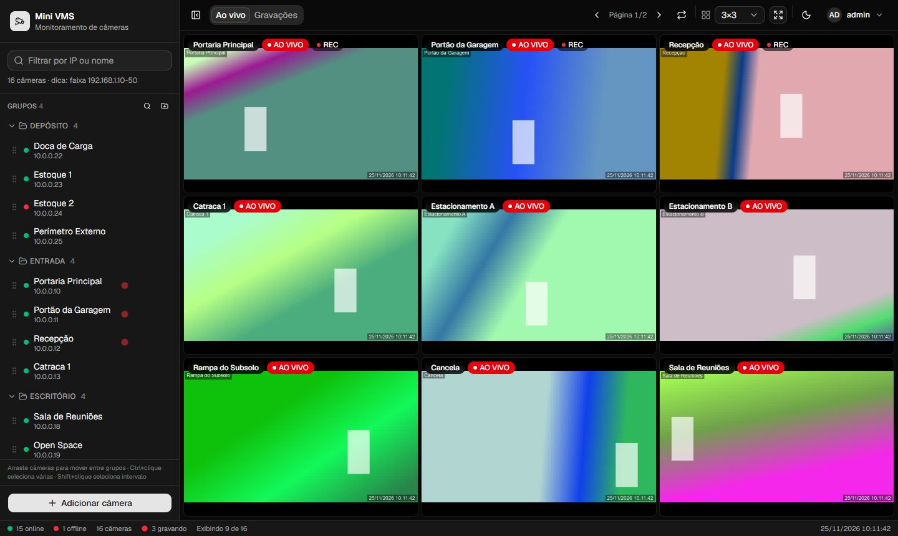
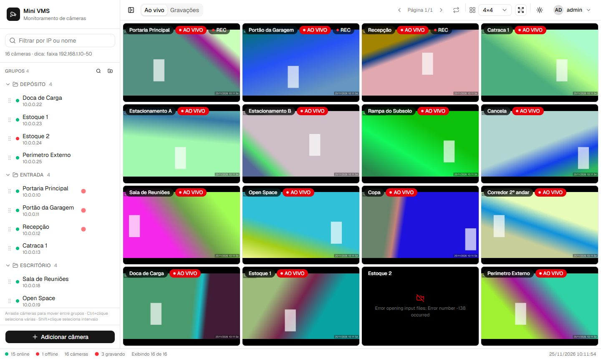
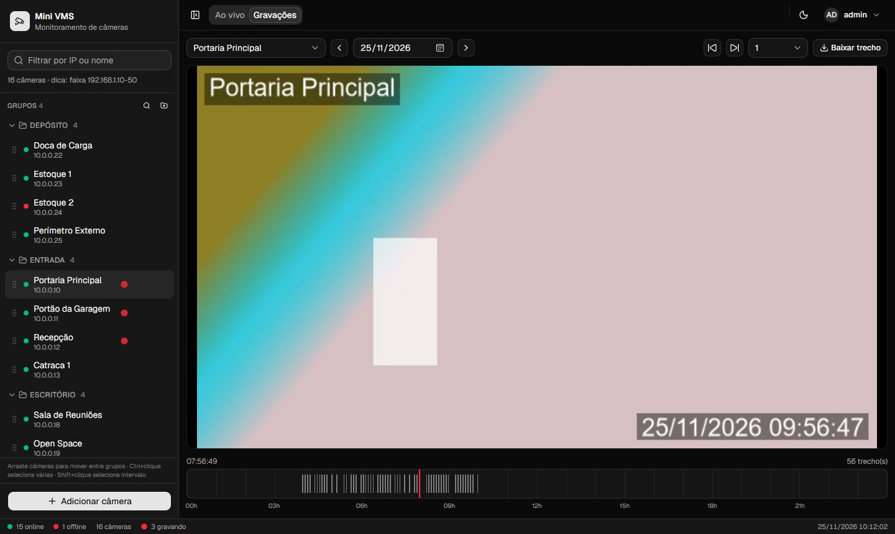
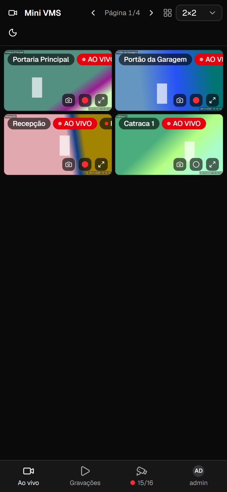
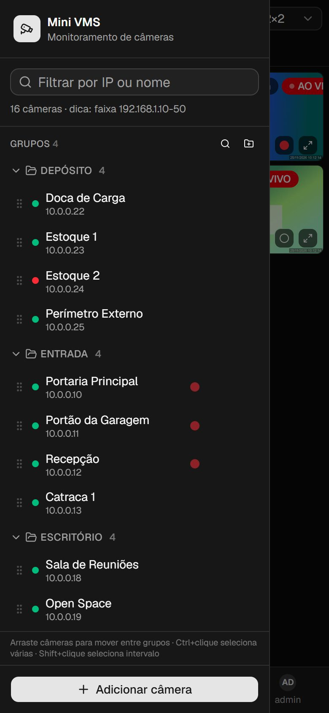

# Mini VMS

Software web de monitoramento de câmeras IP inspirado no Hikvision iVMS-4200: visualização ao vivo em grade, gravação e playback.



<table>
  <tr>
    <td width="50%"></td>
    <td width="50%"></td>
  </tr>
  <tr>
    <td align="center">Tema claro, grade 4×4</td>
    <td align="center">Gravações com linha do tempo</td>
  </tr>
</table>

<p align="center">
  
  &nbsp;&nbsp;
  
</p>

Capturas feitas com o [modo demonstração](#testar-sem-câmeras-modo-demonstração), que usa câmeras simuladas.

- **Servidor:** Node.js sem dependências (`server.js`), usa FFmpeg para RTSP.
- **Interface:** React + Vite + Tailwind + shadcn/ui (pasta `web/`), compilada para `public/`.

## Requisitos
- Node.js 18+
- FFmpeg no PATH (ou `FFMPEG_PATH=C:\caminho\ffmpeg.exe`). Windows: `winget install Gyan.FFmpeg`

## Testar sem câmeras (modo demonstração)
```bash
npm run demo
```
Abra http://127.0.0.1:3000 e use os botões **Entrar como admin** / **Entrar como operador**. Sobe 16 câmeras simuladas em 4 grupos (uma delas "caída", para mostrar o estado de erro), 3 já gravando e com horas de gravações de exemplo na aba Gravações. Na primeira execução compila a interface sozinho.

Como funciona: cada câmera é um vídeo gerado pelo FFmpeg (fundo animado, nome, relógio e um vulto em movimento), então ao vivo, gravação e reprodução passam pelo mesmo caminho do RTSP real, e nenhuma conexão de rede é aberta. Os dados ficam em `data-demo/`, separados de `data/`. Precisa só de Node 18+ e FFmpeg.

Contas da demo: `admin` / `demo1234` (tudo) e `visitante` / `visitante1` (só visualiza).

## Demo hospedada (Vercel)
A Vercel não roda processos longos nem FFmpeg, então a versão hospedada é uma **demo estática**: o mesmo front-end, mas com a API e o vídeo simulados no navegador (`web/src/lib/demo/`). As câmeras são desenhadas num `<canvas>`, as gravações tocam um clipe de exemplo, e câmeras, grupos e usuários funcionam em memória (somem ao recarregar).

- Build: `npm --prefix web run build:demo` (modo Vite `demo`, que liga `VITE_DEMO`). O `vercel.json` já usa esse comando e publica `public/`.
- A branch `main` é a de produção: todo push nela publica de novo a demo. O workflow `.github/workflows/demo-build.yml` compila a demo (e o build normal) a cada push e pull request, para a `main` nunca ficar sem build.
- Para publicar: em vercel.com/new, importe este repositório e mantenha `main` como Production Branch. Não precisa configurar mais nada.

## Rodar
```powershell
npm --prefix web install
npm --prefix web run build
node server.js
```
Abra http://127.0.0.1:3000. **No primeiro acesso, a tela pede para criar o usuário administrador.**

Desenvolvimento da interface com recarga automática (com o servidor rodando): `npm --prefix web run dev`.

## Funcionalidades
**Ao vivo**
- Grade de 1×1 até 8×8 (64 câmeras por página), com paginação (← →) e **sequência automática** de páginas (10 a 60 s).
- Duplo clique amplia a câmera no stream principal (HD), com **zoom digital** pela roda do mouse e arrastar para mover.
- Barra de ferramentas em cada janela: capturar imagem (JPG), gravar, ampliar.
- Tela cheia só da grade.

**Câmeras**
- Cadastro, edição e remoção. Modelos prontos para Hikvision, Intelbras, Dahua e RTSP genérico.
- **Filtro por IP ou nome**, inclusive por faixa: `192.168.1.10-50`. O filtro vale para a lista e para a grade.
- **Grupos/áreas** em árvore: criar (inclusive vazios), pesquisar, renomear (duplo clique) e excluir; "ver só este grupo na grade".
- **Mover câmeras entre grupos arrastando e soltando.** Ctrl+clique seleciona várias, Shift+clique seleciona um intervalo, e o arraste leva toda a seleção. Cada movimento pode ser desfeito pelo aviso.
- **Menu de contexto** (clique direito na área vazia da barra lateral): novo grupo, adicionar câmera, pesquisar grupos, expandir/recolher todos, selecionar câmeras visíveis.
- Status online/offline (verificação da porta RTSP a cada 60 s) e barra de status com contadores e relógio.
- Barra lateral recolhível (Ctrl+B).

**Gravação e playback**
- Botão REC por câmera. Grava o stream principal com `-c copy` (sem re-encodar), em MP4 de 2 min, em `data/recordings/<id>/`. Sem áudio.
- Aba **Gravações**: câmera e dia, linha do tempo de 24h, velocidade 0.5× a 8×, ±10 s, download do trecho.
- Reconecta sozinho se a câmera cair; Ctrl+C finaliza os MP4 antes de sair.
- Câmeras em **H.265** gravam, mas o Chrome pode não reproduzir; para playback no navegador use H.264.

**Usuários**
- Login com sessão (cookie HttpOnly, SameSite=Strict, 12 h). No primeiro acesso a tela cria o administrador.
- Perfis: **Administrador** (tudo) e **Operador** (só visualiza ao vivo e gravações, captura imagem e exporta a lista CSV). As permissões valem no servidor, não só na tela.
- Menu do usuário (canto superior direito): alterar a própria senha, gerenciar usuários, exportar/importar, sair.
- Trocar ou redefinir senha encerra as outras sessões daquele usuário. 5 erros de login em 15 min bloqueiam o IP por 5 min.

**Exportar / importar**
- **Lista de câmeras (CSV)**: nome, grupo, IP, porta, status, gravando. Abre no Excel; sem senhas.
- **Configuração completa (JSON)**: câmeras e grupos, para levar a outro servidor. Pode incluir as senhas das câmeras, que saem criptografadas com uma **frase-senha** escolhida na hora (sem ela o arquivo não importa).
- Importar: **mesclar** (adiciona e atualiza, reconhecendo câmeras por IP + porta) ou **substituir tudo**. A gravação não é ligada na importação.

## Como o ao vivo funciona (e por que carrega rápido)
- O navegador limita 6 conexões HTTP por servidor. Por isso **todas as câmeras da tela passam por uma única conexão** (`/api/live`), num protocolo binário simples: `[tipo][índice][tamanho][JPEG]`.
- Um FFmpeg por câmera/qualidade converte RTSP → JPEG e é compartilhado entre espectadores.
- O FFmpeg continua aquecido por 30 s depois que a câmera sai da tela (`STREAM_LINGER_MS`): voltar a uma página já vista é instantâneo, e o último quadro aparece na hora.
- Sondagem mínima do stream na abertura (`-probesize 32768 -analyzeduration 0`), com volta automática à sondagem normal se a câmera não abrir. `-fflags nobuffer` foi medido e dobrava o tempo de abertura, então não é usado.
- Grades 5×5+ usam 320 px a 5 fps.
- O que sobra do tempo de abertura é a espera pelo próximo quadro-chave da câmera. Para abrir mais rápido, reduza o **intervalo de I-frame** do substream na câmera (ex.: igual ao FPS).

Medido com câmeras Hikvision reais na rede local: 16 câmeras frias abrem com mediana de 3,2 s; 64 câmeras (8×8) abrem todas; páginas já vistas em ~15 ms.

## Configuração (variáveis de ambiente)
| Variável | Padrão | O que faz |
|---|---|---|
| `PORT` / `HOST` | `3000` / `127.0.0.1` | Endereço do servidor |
| `FFMPEG_PATH` | `ffmpeg` | Caminho do FFmpeg |
| `REC_DIR` | `data/recordings` | Pasta das gravações |
| `RETENTION_DAYS` | `7` | Apaga gravações mais antigas |
| `SEGMENT_SECONDS` | `120` | Duração de cada arquivo gravado |
| `STREAM_LINGER_MS` | `30000` | Tempo que o FFmpeg fica aquecido sem espectadores |
| `DATA_DIR` | `data` | Pasta de dados (câmeras, grupos, usuários, chave) |
| `VMS_SECRET` | (vazio) | Chave das senhas das câmeras (mín. 16 caracteres). Se vazio, usa `data/secret.key` |
| `SESSION_HOURS` | `12` | Duração da sessão de login |
| `COOKIE_SECURE` | (vazio) | `1` quando o app estiver atrás de HTTPS |

## Segurança
**Senhas das câmeras**
- Ficam **criptografadas** (AES-256-GCM) em `data/cameras.json`. Senhas antigas em texto puro são convertidas sozinhas na inicialização.
- A chave fica em `data/secret.key` (gerada no primeiro uso) ou em `VMS_SECRET`. Quem copiar só o `cameras.json`, um backup dele ou uma exportação não consegue ler as senhas.
- Não dá para usar hash como nas senhas de usuário: o servidor precisa da senha original para abrir o RTSP. Por isso quem tem acesso total ao servidor (arquivo + chave) ainda consegue recuperá-las. Em produção, prefira `VMS_SECRET` definido no serviço, fora da pasta `data/`.
- **Faça backup de `data/secret.key`** (ou guarde a `VMS_SECRET`): sem a chave, as senhas das câmeras precisam ser digitadas de novo.
- Mensagens de erro do FFmpeg citam a URL com usuário e senha; o servidor as mascara (`rtsp://***@ip`) antes de mostrar na tela.
- A senha nunca é enviada ao navegador, nem aparece no CSV ou na exportação sem frase-senha.
- Limitação: enquanto um stream está aberto, a URL com a senha aparece nos argumentos do processo FFmpeg, visíveis para quem tem acesso ao sistema operacional do servidor.

**Usuários e acesso**
- Senhas de usuário com scrypt + sal (não reversíveis), em `data/users.json`.
- Proteções: cookie HttpOnly/SameSite=Strict, alterações só via JSON (contra CSRF), limite de tentativas de login, CSP e cabeçalhos de segurança.
- Escuta só em 127.0.0.1 por padrão. Para usar na rede: `HOST=0.0.0.0`, de preferência atrás de um proxy HTTPS (com `COOKIE_SECURE=1`). **Crie o administrador antes de expor o servidor**: enquanto não há usuários, qualquer um que abrir a página pode criá-lo.
- A pasta `data/` está no `.gitignore` e nunca vai para o repositório.

## Produção
- Os dados ficam no servidor, em `data/`: copie essa pasta (com `secret.key`) para levar a configuração, ou use **Exportar / importar**.
- Em Docker ou hospedagem com disco temporário, monte `data/` num volume persistente.
- O servidor precisa estar na mesma rede das câmeras (ou ter VPN até ela).
- Rode uma única instância (os dados são arquivos JSON).

## Próximos passos
1. Limite de espaço em disco para gravações e opção de gravar o substream
2. HTTPS embutido / registro de auditoria (quem fez o quê)
3. Descoberta ONVIF + PTZ
4. WebRTC/H.264 (go2rtc) no lugar de JPEG, para menos CPU
5. Eventos/alarmes de movimento
